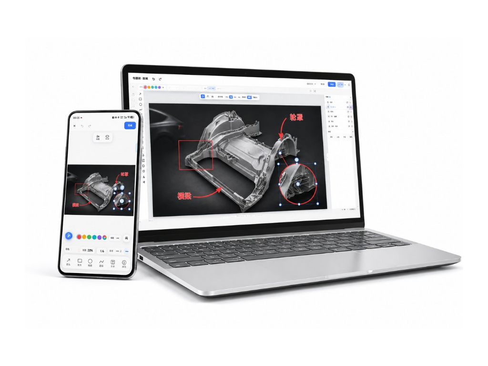

# 勾画阁·猫抓

给思源笔记里的图片画标注、做裁剪。**保存后还是原来那张图**——文件名不变、正文不动，下次右键还能把每一笔改回来。

## 更新记录

**1.4.3** · 2026-11-24

- 优化：移除标注对象的移动按钮。
- 优化：调整文本编辑按钮的位置。
- 修复：画线工具退出时残留预览线段的问题。
- 修复：文本工具输入多字符时编辑框宽度偏窄导致字符被裁的问题。

📖 [查看完整更新日志 (CHANGELOG.md)](https://github.com/Clymer-git/siyuan-plugin-annotate/blob/main/CHANGELOG.md)

## 三个特点

**不用离开思源。** 标注直接在笔记正文里做，画完点保存，正文里那张图就变成成品，不用截图、不用导出、也不用把文件拖来拖去。

**改得回来。** 标注是矢量的，不是画在像素上：字能改、字体能换、线能掰弯、颜色能换、序号能换样式还能自动重排。删掉标注层，底图完好无损。

**不添乱。** 覆盖同一张图，改一百次也只有一个文件；笔记里的图片宽度、图注、旁边的文字都不受影响。

## 标注工具

**十一种标注**：箭头、矩形、椭圆、画线、文本、序号、马赛克、模糊、高亮、聚光灯、放大镜。

几个值得说的：

- **箭头**分「类型」和「端点」两层来选：类型有单头、双头、尖尾（尾细头粗）、两端竖线，端点有基础、燕尾、开放、菱形、圆形；当前类型用不了的端点会置灰，不用去猜。弯成曲线也保持原样，粗细、线型、颜色照样能调；
- **序号**四种外观：实心圆、空心圆、定位气泡、纯数字；定位气泡能拖出引线指到目标上。编号五种格式（数字 / 罗马 / 大小写字母 / 中文），删掉中间一个，后面的自动接上；
- **聚光灯**：框出要照亮的地方，四周自动压暗，压暗的深浅可调。遮罩可选黑色压暗或白色磨砂高亮，深色图上特别有用；
- **放大镜**：镜框和锚点分开——拖锚点换「看哪儿」，框里画面跟着实时更新；
- **高亮**两种画法：涂出一道荧光笔痕迹，或拖出一块半透明色块，色块可选中、搬走、改大小；
- **马赛克 / 模糊**：对这块区域重新采样像素；开「选区识别」后画面会被切成一块块虚线框，点哪个就糊哪里；
- **文本**能用系统里的字体，也能上传自己的字体文件，保存时一并带进图片；输入时就显示成品颜色，碰到右边自动换行，光标按底色明暗自动选黑白。

**智能选择**：手里拿着某个工具时，点按已有的同类标注会直接选中它去调参数，不会又叠一个上去；想画新的，从对象外面起手就行。

**图像处理**：旋转、水平 / 垂直翻转、裁剪（11 档比例）、扩展画布（留白可铺白、黑、自定义色、吸色，也可保持透明）。

**多选与对齐**：一次选中多个对象，八种对齐与分布，整组一起拖。

## 桌面端与移动端

**电脑**：左竖栏挑工具；顶部五组属性框（颜色 / 粗细 / 线型 / 填充 / 字号），点哪一档当场生效，不用展开面板；画布上永远浮着一条参数条；右侧对象列表能调层级、复制、删除。

**画完就能直接调**：选中的图形中央有一枚**移动抓手**，按住就挪，不用先切回选择工具；拖**四角**是等比缩放（图形不会被拉扁），拖**四边中点**才改宽高比；文字右上角另有一枚**小铅笔**，点一下直接回到输入状态。

**手机**：整屏打开，两颗圆钮加底部两条悬浮栏；文字和序号的参数集中在屏幕上方那一条里，点完直接看画布。双指捏合缩放、双指拖动挪画面。还有几个特别顺手的：

- **一指按住、另一指滑动 = 按住 Shift**：画线自动吸成水平 / 垂直 / 45°，矩形椭圆锁成正方形、正圆；
- **两指滑动是缩放，单指才是画**，两种手势互不干扰；
- **打字时底部三栏自动让开**：一弹出键盘，属性栏、工具条、两颗圆钮整块收起，画面缩到键盘上沿，写完字收键盘就回来。

## 保存与再编辑

覆盖笔记里那张图本身。

文件名、路径、图片宽度、图注、旁边的文字——全都不变。双击看大图、手机端、导出 PDF，看到的都是画好的成品。

想改？右键，还是那一项，上次的箭头、文字、裁剪范围都还在；裁剪过的图还能把范围重新拖大，找回之前裁掉的部分。

图片只在本机处理，不会上传到任何服务器；标注数据跟着那张图一起存在笔记里，插件不另存副本。

## 两种打开方式

**入口一：鼠标悬停**

1. 把鼠标移到正文里的图片上，图片右上角会出现一排按钮；
2. 点最左边那颗**编辑图标**，编辑器就打开了。

**入口二：右键菜单**

1. 右键点一下图片；
2. 在菜单里选「**勾画阁·猫抓 编辑**」，编辑器就打开了。

**手机**：轻点图片，右上角同样出现那排按钮，点那颗编辑图标即可。

打开之后：

1. 挑工具，直接在图上画；
2. 点右上角「**保存**」。

| 按键 | 作用 |
| --- | --- |
| `V` `A` `R` `E` `K` `T` `N` | 选择 / 箭头 / 矩形 / 椭圆 / 画线 / 文字 / 序号 |
| `M` `B` `L` `P` `G` | 马赛克 / 模糊 / 高亮 / 聚光灯 / 放大镜 |
| `Shift` 按住再画 | 画线吸 45° 系；矩形、椭圆、聚光灯、放大镜锁 1:1 |
| `Ctrl + Z` / `Ctrl + Shift + Z` | 撤销 / 重做 |
| `Ctrl + S` | 保存并退出 |
| `Delete` | 删除选中对象 |
| `滚轮` / `空格 + 拖动` | 缩放 / 平移画布 |

## 运行环境

思源笔记 **3.0.12** 及以上；桌面端（Windows / macOS / Linux）与移动端（Android / iOS，含手机浏览器）都支持；界面跟随思源的浅色 / 深色主题。

## 参考与致谢

本插件在开发过程中实读了以下开源项目的源码，并借鉴了各自的设计思路与算法，谨向作者致谢：

| 项目 | GitHub | 具体参考了什么 |
| --- | --- | --- |
| **ImgReEditor**（Achuan-2） | https://github.com/Achuan-2/siyuan-plugin-imgReEditor | 裁剪的整套数据流：完整原图、裁剪偏移、裁剪框三件套，以及进入 / 退出 / 应用裁剪的状态切换；框外压暗 45% 的观感；「覆盖同一个图片文件、把工程数据内嵌进去、不另写附档」的封装方式；文字字体选择的思路（用探针读出元素真实字体栈、字体文件存在插件空间、导出时把用到的字体内嵌进图片） |
| **capcap**（realskyrin） | https://github.com/realskyrin/capcap | 箭头的行为与几何（直线 / 二次贝塞尔两种形态、曲线时头部方向取末端切线）；马赛克「从底图重新采样一块区域」的实现依据，而不是贴一层色块 |
| **ShareX**（ShareX Team） | https://github.com/ShareX/ShareX | 箭头七种样式的几何比例：头宽、头长、翼角约 35°、曲线主干、折角容许值；矩形圆角的档位与顺序；标注工具的命名与分组逻辑 |
| **Anot8**（ksprashu） | https://github.com/ksprashu/anot8 | 坐标体系：viewBox 恒定、缩放平移只改 CSS transform、所有坐标以图片原始像素表示；以指针为焦点的缩放算法；色值与对比度算法（含按相对亮度自动选黑白文字） |
| **Colorink**（yuebai777） | https://github.com/yuebai777/colorink | 色轮的结构与布局：外圈空心色相环、中间内接饱和度 / 明度方块、环上白圈定色相、方块里小圈定浓淡，下方是预览块 + 色号（HEX / RGB 可切换）+ 色相 / 浓度 / 明度三格读数 |
| **Snow Shot**（mg-chao） | https://github.com/mg-chao/snow-shot | 选区识别的分区思路：先估一块区域自己的底色、只把与紧邻像素有反差的部分当内容；用开运算扣掉卡片边框和分割线这类长横线 / 长竖线；按字高定核把同一行文字连成一条；把图标、图片这类大块单独摘出来，不与文字粘连 |
| **思源笔记 SiYuan** | https://github.com/siyuan-note/siyuan | 运行平台与公开的文件 / 块 / 属性 API；插件加载器与集市包的规范依据；界面配色与交互尽量与思源原生保持一致 |

问题与建议请提到 [GitHub Issues](https://github.com/Clymer-git/siyuan-plugin-annotate/issues)。项目以 MIT 协议开源，可以按自己的需要改。感谢所有开源作者的分享。
